# 文字变形实验

从任意字体取出轮廓，自动分析出每一笔的末端和骨架，再按一份 JSON 配方逐步改造字形：拉长卷起末端、改末端形状、用单线笔或扁笔尖重描、把点换成圆、倒圆角、切开、几何化、加内刻线，最后排版加装饰，输出 PNG、SVG 和 flexlayer 的 `.layer`。

另一条路是先把字变成「骨架字形」：按笔顺排好的一组中心线，每笔带类型、逐点宽度和两端是自由还是接在别的笔上。骨架上可以单独转动、拉长、卷起、抖动、连笔，最后用一支可调压力、可出锋的笔画回轮廓。很多字体设计其实就是「骨架变形 + 笔刷」。

骨架也可以完全不从字体来：`"font": "hanzi"` 时直接用开源的 [Make Me a Hanzi](https://github.com/skishore/makemeahanzi) 逐笔中心线，不读任何字体文件。同一副骨架先做变形（规整、圆转、抖动、飞扬、连笔），再换不同的笔刷（单线、圆体、毛笔、飞白、平笔、空心、点阵……），就是不同的风格，见[开源骨架加笔刷](#开源骨架加笔刷)。

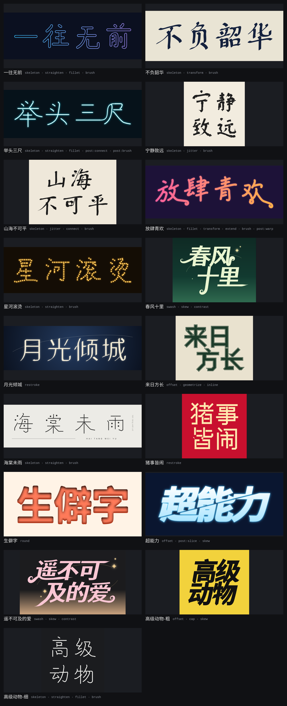

`lab/recipes` 里每份配方对应一种风格，`npm run lab:gallery` 把它们全部渲染后拼成上面这张图。

这里的代码只是实验，不属于 `anyfontweight` 的公开接口。

## 流程

1. **取字**：[flexlayer](https://github.com/ruochi/flexlayer) 的 `glyph()` 给出单字的 SVG 路径，展开成折线。
2. **字重和对比**（可选）：`synthWeight` 用本库的 `anyFontWeight` 合成字重，比如寒蝉端黑体只有 300 的轮廓，可以合成到 800。`contrast` 让竖画、横画分别加粗或变细。
3. **分析**，两套互相补充：
   - **末端**：沿轮廓找约 180° 的凸转弯，要求两侧边近似平行，开口宽度和 `computeMedial` 量出的笔画宽度对得上。逐笔重叠的字体先按外轮廓分组再量，藏在别的笔画里的末端会被去掉。
   - **骨架**：把字栅格化，做距离变换和细化，得到中心线图。图里有端点、交叉点和边；在交叉点把走势最顺的两条边接成一笔，再按长度、角度、转折分成横、竖、撇、捺、点、提、折。独立的小块记为「点」。
4. **逐字操作**：配方里的 `steps` 依次作用在每个字上。末端类操作改轮廓的局部，骨架类操作按中心线重新生成轮廓，形状类操作用 [Clipper](http://www.angusj.com/delphi/clipper.php) 做布尔运算和偏移。骨架字形的操作见下文[骨架字形](#骨架字形)。
5. **排版**：按配方分行、错位、倾斜。
6. **整段操作**：`post` 里的操作作用在排好的整段文字上，比如一刀切过所有字，或者把字和字连笔。
7. **装饰和输出**：加星星、环线、拼音、线条，交给 flexlayer 渲染。轮廓先拟合成三次贝塞尔曲线（误差约 0.0012 em）再写进 SVG 和 `.layer`，配方里写 `"curves": false` 则保留折线。

## 用法

```bash
npm install
# 1. 先分析，得到带编号的末端图、骨架图和清单
npm run lab:analyze -- lab/recipes/遥不可及的爱.json
# 2. 写配方，再渲染
npm run lab:render -- lab/recipes/遥不可及的爱.json
# 3. 全部配方拼一张总览
npm run lab:gallery
# 4. 比较三种骨架来源（文字、字体、字重、输出路径）
npx tsx lab/deform/compare.ts 海棠未雨母可 NotoSans 400
# 5. 审阅：逐字指标、问题清单和诊断图，见下文
npx tsx lab/deform/review.ts lab/recipes/山海不可平.json --ref Kai
```

结果在 `lab/out/`。也可以直接分析一段文字：`npm run lab:analyze -- 春风十里 ChillDuanSans 300 800`（文字、字体、字重、合成字重）。`lab:render` 的第三个参数是缩放，默认 0.5。

分析会输出四份文件：

- `.terminals.png`：末端编号。粉色的末端前方开阔，适合夸张；蓝色的末端很快会撞到本字其它笔画。
- `.skeleton.png`：从轮廓自动细化出的骨架。颜色是笔画类型，标签是「类型+编号」，白点是交叉点，虚线圈是识别出的点。
- `.strokes.png`：骨架字形。颜色是笔画类型，数字是笔顺，箭头是书写方向，空心圈表示这一端接在别的笔画上，右上角是骨架来源。
- `.analysis.json`：给模型读的清单，`terminals`（末端）、`skeleton`（自动骨架）、`strokes`（骨架字形）三部分。

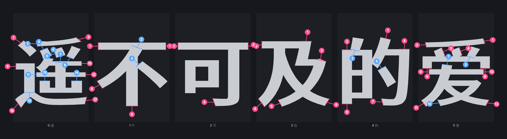

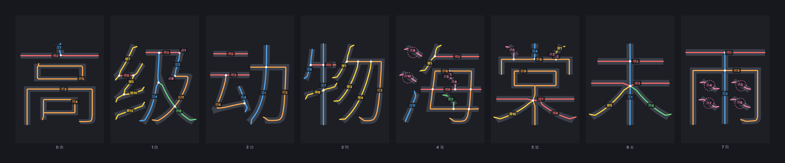

末端清单里每个末端有：

| 字段 | 含义 |
| --- | --- |
| `id` | 配方里引用它的名字，如 `爱.13` |
| `dir`、`angle` | 末端朝向，`右` 是 0°，顺时针为正 |
| `at` | 末端在字身盒子里的位置，0 到 1 |
| `width` | 笔画宽度（em） |
| `run` | 末端后面笔画保持顺直的长度（em），越长越像一笔长画 |
| `free` | 顺着末端方向到本字其它墨迹的距离（em），`null` 表示一路开阔 |

自动骨架清单里每一笔有 `id`（如 `雨.s3`）、`type`、`length`、`angle`，以及起止点 `from`、`to`；`dots` 是识别出的点的位置。

骨架字形清单里每一笔有 `id`（如 `雨.3`，数字就是笔顺）、`type`、`length`、`width`、起止点 `from`、`to`，以及两端 `start`、`end`：`free` 是自由端，`joint:2` 是接在第 2 笔上。

前面的操作会改变轮廓，末端编号也跟着变。分析配方时会先执行到第一个按编号点名末端的步骤之前，清单里的编号就是那一步看到的编号，清单的 `stoppedBefore` 记着停在哪一步。

## 配方

长度单位都是 em，角度是度。屏幕坐标 y 向下，0° 朝右，90° 朝下。

| 字段 | 含义 |
| --- | --- |
| `lines` | 每行的文字 |
| `font`、`weight` | flexlayer 的字体名和字重。可变字体只能取默认字重。写 `hanzi` 时不用字体，字形来自开源逐笔数据 |
| `synthWeight` | 用 `anyFontWeight` 合成的字重 |
| `contrast` | `{ vertical, horizontal }`，竖画、横画各自加粗多少，负数变细 |
| `tracking`、`leading`、`indent` | 字距、行距、每行缩进 |
| `glyphs` | 单字微调 `{ dx, dy, scale, rotate }`，键是字序号或字本身 |
| `skew` | 整体倾斜，正数向右倒 |
| `steps` | 逐字操作，见下文 |
| `post` | 排版后对整段文字的操作，写法同 `steps` |
| `swashes` | 旧写法，等于排在最前面的 `{ "op": "swash", "items": [...] }` |
| `fill`、`glow`、`background` | 字色、发光、背景（可以写 `linear-gradient(...)`、`radial-gradient(...)`） |
| `attrs` | 原样写到字形上的 flexlayer 效果，如 `{ "inner-shadow": "0 -10 14 #0006", "shadow": "0 14 0 #b23a1f" }` |
| `decor` | 装饰，见下文。坐标以第一行字身左上角为原点 |
| `padding` | 画面四周留白 |
| `curves` | 默认 `true`，输出前把轮廓拟合成贝塞尔曲线 |

### 操作

每一步写成 `{ "op": "名字", ...参数 }`。加上 `"glyphs": [0, "爱"]` 只作用于部分字，数字是全文字序号，字符串是字本身。

| `op` | 参数 | 作用 |
| --- | --- | --- |
| `swash` | `items: [{ target, ...飘带参数 }]`，或 `select` 加飘带参数 | 末端长出飘带，见下表 |
| `cap` | `style`: `round`、`point`、`cut`、`ball`；`angle`（斜切角，默认 35）；`size`；`select` | 改末端形状 |
| `restroke` | 见下表 | 按骨架用单线笔或扁笔尖重描 |
| `dots` | `shape`、`size` 或 `scale`、`maxSize`（默认 0.2）、`angle` | 把独立的小块换成图形 |
| `round` | `convex`、`concave`（圆角半径） | 凸角、凹角倒圆。凹角半径太大会填死窄字腔 |
| `offset` | `delta`、`join`（`round`、`miter`、`square`） | 整体外扩或内缩。比 `synthWeight` 稳，但字腔会同样变窄 |
| `contrast` | `vertical`、`horizontal` | 同配方里的 `contrast`，可以放在别的操作之后 |
| `outline` | `width` | 只留一圈边，变成空心字 |
| `inline` | `width`、`inset` | 在笔画里离边 `inset` 处刻一道宽 `width` 的线 |
| `slice` | `angle`、`gap`、`at`（0–1，可以是数组）、`shift` | 用直线切开；`shift` 让切线一侧沿切线错开 |
| `geometrize` | `tolerance`、`snap` | 简化轮廓，再把每条边吸附到 `snap` 度的整数倍 |
| `warp` | `kind`: `arc`、`wave`；`amount`；`period`（波长） | 整体弯成拱形或波浪，放在 `post` 里弯整段文字。作用在骨架字形上时只移动中心线，笔宽不变 |

另有一组操作作用在骨架字形上，见[骨架字形](#骨架字形)。

`restroke` 的参数：

| 参数 | 默认 | 含义 |
| --- | --- | --- |
| `width` | | 笔宽 |
| `widthByType` | | 各类笔画单独的笔宽，如 `{ "竖": 0.05, "横": 0.02 }` |
| `pen` | `round` | `nib` 是扁笔尖，笔尖长 `width`、厚 `width·nibThin`，与水平成 `nibAngle` 度 |
| `nibAngle`、`nibThin` | -40、0.25 | |
| `cap`、`join` | `round`、`round` | 笔头和拐角 |
| `smooth` | 0 | 中心线再平滑多少 |
| `simplify` | 0.002 | 中心线简化容差，大一点更硬朗 |
| `snap` | | 线段方向吸附到多少度的整数倍 |
| `gap` | 0 | 止于别的笔画的一端留缝，像镂空模板字 |
| `fit` | `true` | 自由末端回缩半个笔宽，圆头不超出原字身 |
| `dots` | | `{ shape, size 或 scale, angle }`，点画换成图形 |

图形 `shape` 可选 `circle`、`ring`、`square`、`diamond`、`triangle`、`sparkle`、`drop`。

### 选末端

`swash` 和 `cap` 的 `select`：

| 字段 | 含义 |
| --- | --- |
| `ids` | 末端编号（从 1 起），配合 `glyphs` |
| `dir` | 朝向列表，用 右、右下、下、左下、左、左上、上、右上 |
| `free` | `open` 前方空旷，`blocked` 前方不远处有别的墨迹 |
| `minRun`、`minWidth`、`maxWidth` | 按笔画顺直长度和宽度筛 |
| `region` | 末端落在字身盒子里的范围 `[x0, y0, x1, y1]`，0–1；`post` 里是整段文字的包围盒 |

不写 `select` 就是全部末端。

### 飘带参数

| 字段 | 默认 | 含义 |
| --- | --- | --- |
| `target` | | 末端编号，同一个字出现多次时写字序号，如 `5.13` |
| `length` | 0.3 | 延长段长度 |
| `bend` | 0 | 延长段总共拐多少度 |
| `curl` | 0 | 末尾卷几圈，正负是方向 |
| `curlRadius` | 0.12 | 开始卷时的半径 |
| `curlTighten` | 0.4 | 卷到最后半径缩到多少倍 |
| `taper` | 0.15 | 末端宽度比例，0 是尖头 |
| `swell` | 0 | 中段鼓起的比例 |
| `holdWidth` | 0.25 | 宽度从第几成长度开始收 |

### 装饰

| `type` | 参数 |
| --- | --- |
| `sparkle`、`dot` | `at`、`size`、`color` |
| `orbit` | `center`、`rx`、`ry`、`rotate`、`from`、`to`、`width`、`color` |
| `line` | `points`、`width`、`dash`（[实, 虚]）、`cap`、`color` |
| `text` | `text`、`at`（文字块中心）、`size`、`font`、`weight`、`letterSpacing`、`vertical`、`rotate`、`color` |

拼音带声调时用 `Inter` 字体，NotoSans 里没有这些字母。NotoSans 的字身高约 1.45 em，墨迹大致在 y 0.32–1.23 em 之间，摆装饰时可以参考。

## 开源骨架加笔刷

```bash
npx tsx lab/deform/matrix.ts [文字，默认 永字八法] [笔刷,…] [输出路径]
```

`matrix.ts` 把同一段文字按「变形 × 笔刷」排成一张表，每行一种笔刷预设，每列一种骨架变形，全部用 `"font": "hanzi"`。下图是 12 种笔刷乘 6 种变形，约 40 秒。

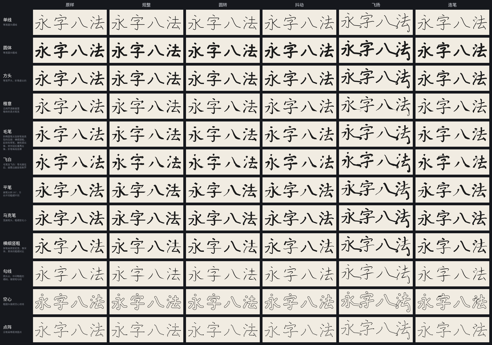

| 列 | 步骤 |
| --- | --- |
| 原样 | 只转骨架 |
| 规整 | `straighten`：楷体微斜的横竖拉正，去掉起笔小钩 |
| 圆转 | `straighten` 再 `fillet`，折角变圆 |
| 抖动 | `jitter`，手写感 |
| 飞扬 | 横画斜 7°，捺拉长卷起，撇尾弯出去 |
| 连笔 | `connect`，按笔顺加牵丝 |

`"font": "hanzi"` 的字形是逐笔轮廓的并集，方框 1 em，基线在 0.88 em；骨架来源默认是 `hanzi`，不做配准，所以比 `hybrid` 快很多，每个字几十毫秒。逐笔数据本身是楷体结构，中线点很稀（每笔 4 到 10 个点），转成骨架时用向心 Catmull-Rom 样条插值，转角超过 45° 的地方断开，折角不会被抹圆。数据里没有的字退回 NotoSans。

笔刷预设在 `lab/deform/brushes.ts`，配方里写 `{ "op": "brush", "preset": "毛笔" }`，再写别的参数覆盖预设：

| 预设 | 做法 |
| --- | --- |
| 单线 | 等宽圆头细线，0.028 em |
| 圆体 | 等宽圆头粗线，0.085 em |
| 方头 | 等宽平头，折角是尖的 |
| 楷意 | 沿用逐笔数据里楷体的逐点笔宽 |
| 毛笔 | 斜椭圆笔尖加按笔画类型的压感：横细竖粗，起收有顿笔，撇和提出锋，捺先轻后重再出锋，折笔每段各算 |
| 飞白 | 毛笔拆成 9 根笔毛，越往后、越靠边越容易断开 |
| 平笔 | 扁笔尖斜 35° |
| 马克笔 | 宽扁笔头，粗细变化小 |
| 横细竖粗 | 按笔画类型定宽，像宋体的粗细对比 |
| 勾线 | 两头尖、中间略粗的细线 |
| 空心 | 粗圆头描成空心双线 |
| 点阵 | 沿笔画等距排圆点，交叉处不重复 |

## 骨架字形

骨架字形是一组按笔顺排好的笔画，每笔有：

| 字段 | 含义 |
| --- | --- |
| `type` | 横、竖、撇、捺、点、提、折 |
| `pts` | 按书写方向的中心线，约每 0.008 em 一个点 |
| `width` | 每个点的笔宽，取自字体本身 |
| `start`、`end` | `free` 自由端，或 `joint` 接在哪一笔上 |

### 三种来源

`{ "op": "skeleton", "source": "hybrid" }` 选来源，默认 `hybrid`。没写 `skeleton` 时，第一个骨架操作也会按默认来源自动转换。

| `source` | 做法 | 长处和短处 |
| --- | --- | --- |
| `auto` | 从轮廓细化出的骨架，在交叉点把走势最顺的边接成一笔 | 不需要外部数据，任何字形都能用；笔顺是按位置猜的，粘连的笔画会被拆错或并错 |
| `hanzi` | [Make Me a Hanzi](https://github.com/skishore/makemeahanzi) 的逐笔中心线，按包围盒对齐到字体 | 笔顺、拆笔都对；但它是楷体结构，和黑体等字体的位置、角度对不上 |
| `hybrid` | 把 `hanzi` 的中心线配准到 `auto` 骨架上，再逐点吸附、平滑；宽度从字体量，自由端延伸到墨迹边缘，接头延伸到被接的那一笔 | 笔顺和结构来自 `hanzi`，形状来自字体 |

`hybrid` 的配准分三步：

1. 包围盒对齐之后，用点到线的 ICP 求 x、y 各自的缩放和平移。
2. 用带方向权重的非刚性 [Coherent Point Drift](https://arxiv.org/abs/0905.2635)（平滑半径 0.5 em）把楷体中心线整体拉到字体骨架上。每个骨架点都要有笔画来解释，所以「可」的竖钩不会被「口」的右边抢走，「尺」的横折会被拉到黑体更宽的框上。
3. 每笔按转角分段，各自在附近细找吸附点。

在 `lab/bench` 的两组字上，骨架保真（见[审阅](#审阅)）的变化如下。基准是 41 个字，用 NotoSans；留出是 32 个字，用寒蝉端黑体，不参与调参。

| 做法 | 基准 | 留出 |
| --- | --- | --- |
| `hanzi` 只按包围盒对齐 | 0.270 | |
| 逐笔找最近点 | 0.743 | 0.781 |
| 加 ICP 和分段 | 0.788 | |
| 加 CPD（现在的 `hybrid`） | 0.891 | 0.882 |
| `auto`，参考上限 | 0.945 | 0.945 |

`auto` 本来就是从字体骨架来的，覆盖率最高，但笔顺和拆笔是猜的。

字库里查不到的字（如标点、生僻字）自动退回 `auto`。逐笔数据经 [hanzi-writer-data](https://github.com/chanind/hanzi-writer-data) 从 jsDelivr 下载，缓存在 `~/.cache/anyfontweight-lab/hanzi/`，许可是 Arphic Public License。

下图从上到下是 `auto`、`hanzi`、`hybrid`。`auto` 把「未」的笔顺排错，把「母」的几笔并成了一笔；`hanzi` 结构对但偏离字形；`hybrid` 两者兼顾。

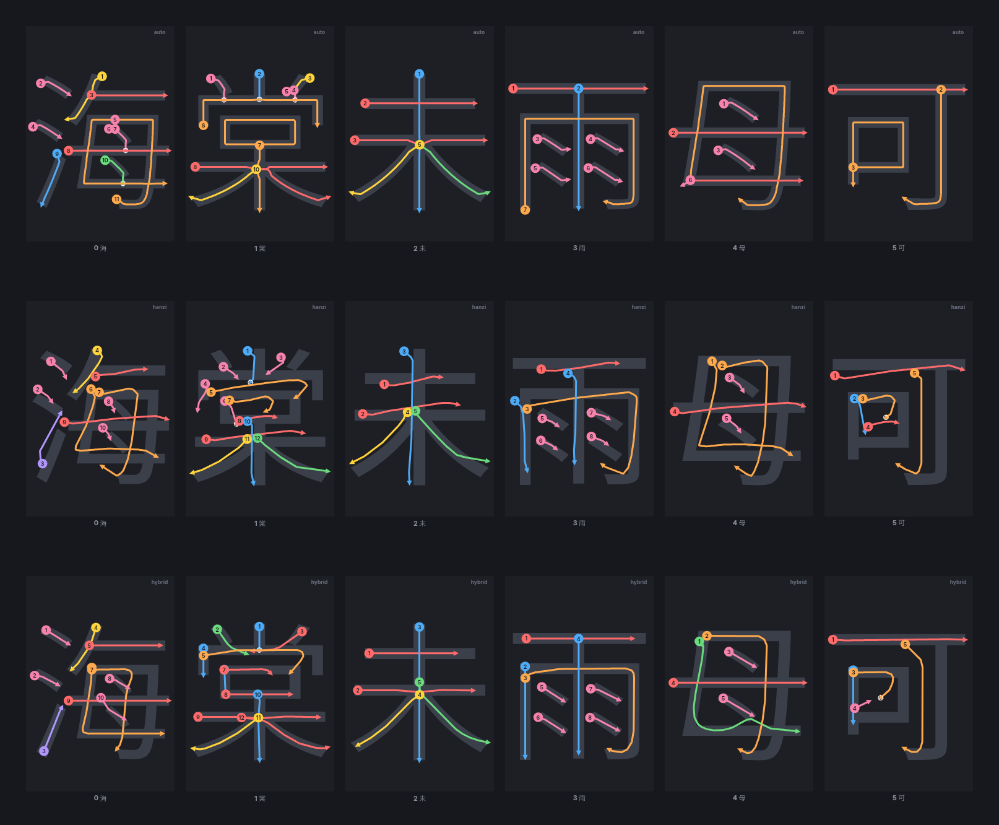

### 骨架操作

| `op` | 参数 | 作用 |
| --- | --- | --- |
| `skeleton` | `source` | 转成骨架字形 |
| `transform` | `rotate`、`scale`、`scaleX`、`scaleY`、`dx`、`dy`、`origin`（`center`、`start`、`end`） | 每笔绕自己的中心、起点或终点旋转缩放平移 |
| `extend` | `start`、`end`（负数是剪短）、`bend`、`curl`、`curlRadius`、`curlTighten`、`taper` | 两端拉长、拐弯、卷起，参数同飘带 |
| `snap` | `angle`、`tolerance`（默认 0.01） | 简化后把线段方向吸附到 `angle` 的整数倍 |
| `smooth` | `amount` | 中心线高斯平滑 |
| `straighten` | `within`（12）、`tolerance`（0.035） | 规整：在 25° 以上的转角处分段，和水平、竖直相差 `within` 度以内、又够直的段拉成正横正竖，正横接正竖时交在同一个角上；楷体起笔的小钩、收笔的小尾巴去掉。长段允许的偏差放宽到段长的 5% |
| `fillet` | `radius` | 圆转：转角附近换成圆滑的弯，两端不动 |
| `jitter` | `amount`、`wavelength`（默认 0.2）、`seed` | 低频抖动，像手写 |
| `connect` | `maxGap`（0.45）、`tension`（0.35）、`width`（0.3）、`minDot`（-0.75）、`across` | 连笔，见下文 |
| `brush` | 见下表 | 画回轮廓 |

`transform`、`extend`、`snap`、`smooth`、`straighten`、`fillet`、`jitter` 可以加 `select` 只改部分笔画：

| 字段 | 含义 |
| --- | --- |
| `ids` | 笔顺号，从 1 起 |
| `types` | 笔画类型列表，如 `["捺", "撇"]` |
| `nth` | 第几笔，负数从末尾数，如 `[1, -1]` 是首笔和末笔 |
| `region` | 笔画中点落在字身盒子里的范围 `[x0, y0, x1, y1]` |
| `links` | 是否包括连笔生成的牵丝，默认不包括 |

`connect` 按笔顺把上一笔的收笔和下一笔的起笔用一段三次曲线接起来，像行书的牵丝。两点距离超过 `maxGap` 的不连；收笔或起笔方向和连线方向夹角太大（余弦小于 `minDot`）的也不连，否则会绕大圈。方向越背离，曲线收得越紧。`width` 是牵丝相对笔宽的比例。写在 `post` 里加上 `across`，就改成把每个字的末笔接到下一个字的首笔，做一笔写完的霓虹字。

`brush` 的参数：

| 参数 | 默认 | 含义 |
| --- | --- | --- |
| `width` | `source` | 笔宽（em）；`source` 用字体量出的逐点笔宽 |
| `scale` | 1 | `source` 宽度的倍数 |
| `widthByType` | | 各类笔画单独的笔宽 |
| `pen`、`nibAngle`、`nibThin` | `round` | 同 `restroke`，`nib` 是扁笔尖 |
| `cap`、`join` | `round` | 笔头和拐角，`cap` 可以是 `butt`、`square` |
| `pressure` | | 沿每一笔均匀分布的宽度倍数，如 `[0.7, 1.15, 0.95, 0.5]` 是起笔轻、中段重、收笔轻 |
| `taper` | | `[起笔, 收笔]` 各用多长（em）收成尖，出锋 |
| `fit` | `true` | 自由端回缩半个笔宽，圆头不超出原来的长度 |
| `dots` | | `{ shape, size 或 scale, angle, all }`，短的点画换成图形；默认只换两端都自由的点，`all` 时接在别的笔上的点也换 |
| `preset` | | 笔刷预设名，见[开源骨架加笔刷](#开源骨架加笔刷)；没有这个名字会报错 |
| `tip` | | `{ angle, thin }`，变宽笔画的笔尖印换成斜 `angle` 度、短轴是长轴 `thin` 倍的椭圆，横比竖细 |
| `pressureByType`、`taperByType` | | 各类笔画单独的压感和出锋，覆盖 `pressure`、`taper`。折笔按转角分段，每段按横、竖、撇、提各算一遍 |
| `bristles` | | `{ count, dry, seed }`，飞白：一笔拆成 `count` 根笔毛，各自沿长度有平滑噪声，低于阈值处断开，`dry` 越大越干 |
| `hollow` | | 画完后只留这么宽（em）的一圈边，成空心双线 |
| `stamp` | | `{ shape, spacing, size 或 scale, angle }`，沿笔画每隔 `spacing` 盖一个图形；离别的笔画已盖的点太近就跳过 |

`steps` 里有骨架操作而 `post` 里也有时，骨架字形会跟着排版一起带进 `post`，可以在整段上连笔再统一下笔。`steps` 结束还没 `brush` 的话，按字体原来的笔宽画回去。

## 风格配方

| 配方 | 做法 |
| --- | --- |
| 遥不可及的爱、春风十里 | 选几个开阔的末端长出飘带卷起，加横竖对比和倾斜 |
| 高级动物-细 | 开源骨架规整、圆转，单线笔 |
| 海棠未雨 | 开源骨架规整，单线方头笔，点换成圆，宽字距，英文副标题和竖排拼音 |
| 山海不可平 | 开源骨架抖动、连笔，毛笔 |
| 放肆青欢 | 开源骨架圆转，横画统一斜 7°，捺拉长卷起，圆体笔，整段弯成拱形 |
| 举头三尺 | 开源骨架规整、圆转，排版后字与字首尾连笔，细圆头笔加发光，像一笔写完的霓虹灯 |
| 宁静致远 | 开源骨架轻微抖动，飞白 |
| 星河滚烫 | 开源骨架规整，点阵加发光，像灯泡招牌 |
| 不负韶华 | 开源骨架横画斜 5°，平笔 |
| 一往无前 | 开源骨架规整、圆转，空心双线，渐变 |
| 高级动物-粗 | 外扩加粗，向下的开阔末端斜切，倾斜 |
| 超能力 | 外扩加粗，排版后整段斜切一刀并错开，渐变加发光 |
| 月光倾城 | 扁笔尖重描，出书写感的粗细变化 |
| 生僻字 | 合成粗字重，大圆角，内阴影加实心投影 |
| 猪事皆闹 | 粗方头重描，交叉处断开，方向吸附到 45° |
| 来日方长 | 外扩，几何化吸附 45°，内刻线 |

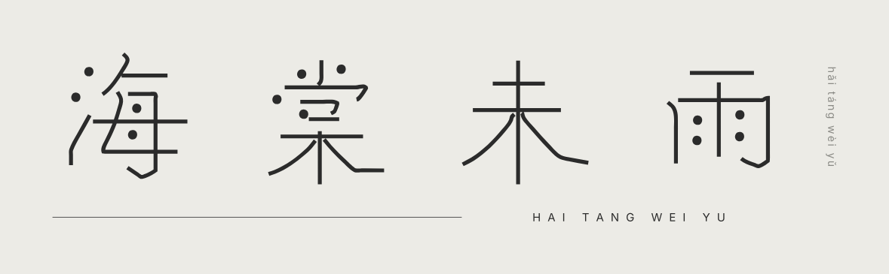

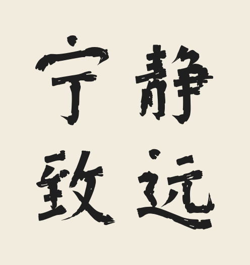

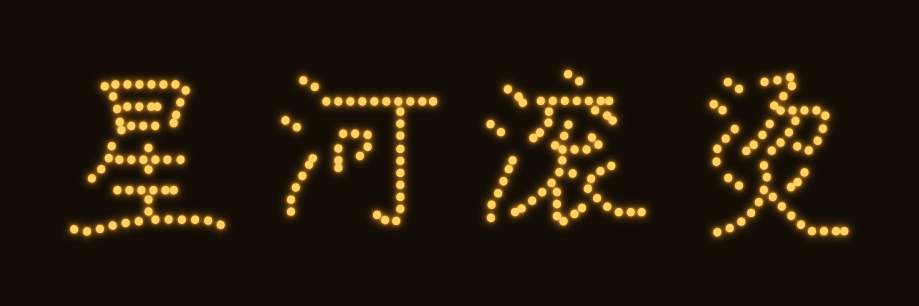

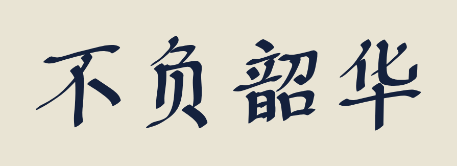

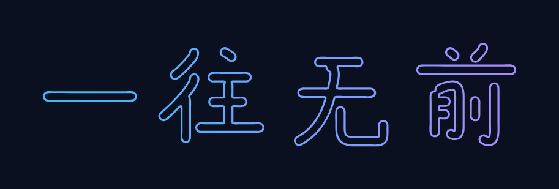


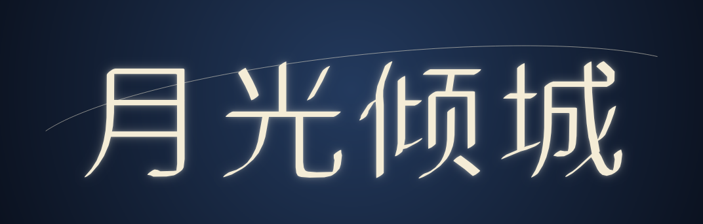

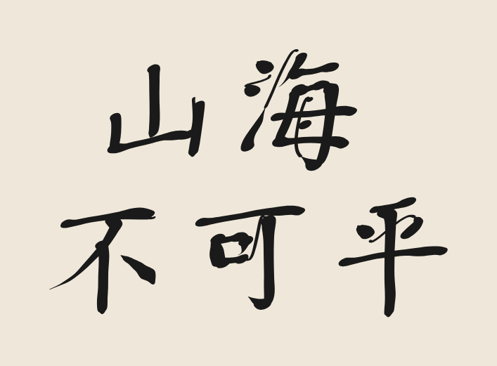

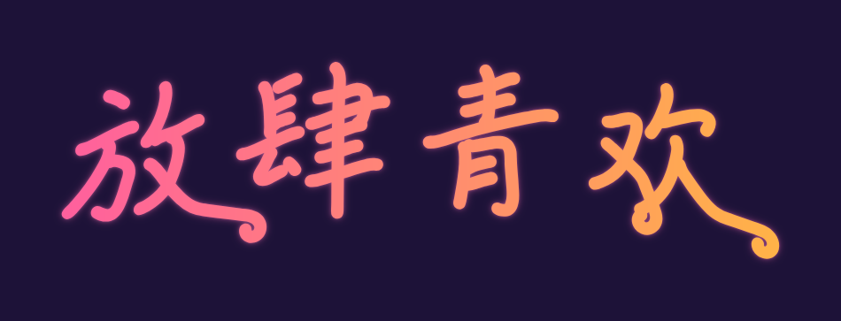

## 审阅

渲染出的成品图很难看出毛病：缩小以后，一笔吸错了位置、一根牵丝压过别的笔画都不显眼。`review.ts` 把每份配方拆开来检查，几秒钟出结果。

```bash
npx tsx lab/deform/review.ts lab/recipes/山海不可平.json [--ref Kai] [--glyphs 0,2] [--brief]
```

终端里先打印逐字指标，再列出带编号的问题：

```
字   保真  保留  溢出  问题
1 海  0.88  0.83  0.12  1
合计：平均保真 0.909，问题 3（骨架漏墨 2、牵丝穿笔 1）
  [2] 海 牵丝穿笔：7→8 的牵丝压过第 6 笔
  flexlayer：没有问题
```

| 指标 | 含义 |
| --- | --- |
| 保真 | 骨架字形按字体原宽画回去，和原字的交并比。只看骨架提取，不受后面变形影响 |
| 保留 | 成品盖住了原字多少墨 |
| 溢出 | 成品多出原字多少墨，按原字面积算 |

| 问题 | 怎么判断 |
| --- | --- |
| 骨架漏墨 | 原字里有一块墨没有任何骨架经过，通常是漏了一笔或吸错了位置 |
| 笔画离墨 | 某一笔不到 85% 的点在原字墨迹里 |
| 牵丝穿笔 | 连笔的牵丝中段压在别的笔画上 |
| 牵丝绕圈 | 牵丝总转角超过 220° |
| 碎块 | 成品里孤立的小块 |
| flexlayer … | flexlayer 渲染报告里的问题，比如字或光晕超出画布 |

同时输出 `lab/out/<名字>.review.png`。每个字一行，从左到右依次是：

- 骨架：实际画的中心线，带笔顺号，牵丝是白色虚线；
- 结果；
- 差异：灰色是两边都有的墨，蓝色是丢掉的，橙色是多出来的，问题用编号圈出来，编号和终端里一致；
- 参照：写了 `--ref` 时，用 flexlayer 自带的字体（如 `Kai`、`Brush`、`MaoCao`）画同一个字，对齐到原字墨迹。

`--set` 给配方里某个参数多个取值，渲染一张对比图 `<名字>.sweep.png`，每格下面写问题数：

```bash
npx tsx lab/deform/review.ts lab/recipes/山海不可平.json --set steps.2.maxGap=0.3,0.5,0.8
```

`lab/bench` 里的两份配方只做 `skeleton`，用来衡量骨架提取：

```bash
npx tsx lab/deform/review.ts lab/bench/基准.json --brief
npx tsx lab/deform/review.ts lab/bench/留出.json --brief
```

## 让模型来做

模型不用读写路径坐标，只做三件事：

1. 看分析图和 `.analysis.json`，决定改哪里。末端类效果挑 `free` 为 `null`、`run` 较长、朝向画面空白处的末端，每行一两处就够；批量效果用 `select` 按朝向、区域筛。骨架字形的操作看 `.strokes.png` 和清单里的 `strokes`，按笔顺号、类型或首末笔挑笔画。
2. 写 `steps`、`post` 和排版参数。
3. 跑 `review.ts`，先看终端里的问题清单，再看诊断图里圈出来的位置，调参数再审阅。拿不准参数时用 `--set` 一次比几个取值。

## 已知限制

- 黑体类字体效果最好。宋体、楷体的衬线和尖头末端检出率低。
- 自动骨架在笔画交叉很密的字上（如「母」里的两点）会接出短斜线；挨得很近的两个交叉点会被并成一个。`hybrid` 骨架字形没有这个问题。
- `dots` 操作只换独立成块的点；骨架字形的 `brush` 加 `dots.all` 才能换掉粘在别的笔画上的点。
- `hybrid` 能吸收楷体和字体之间的比例差，但笔画结构本身不同时（如美术字省掉、并掉的笔画）仍会错位。先跑 `review.ts` 看「骨架漏墨」和「笔画离墨」，多的话改用 `auto`。
- `hybrid` 每个字要做一次 CPD，比 `auto` 慢，大约 0.5 秒一个字。
- `"font": "hanzi"` 的结构是楷体的：字身偏小、横画上斜、钩和点有楷体的形态。`straighten` 能拉正横竖，但「口」「日」这类框的比例、偏旁的位置不会变成黑体那样；要黑体结构就用字体加 `hybrid`。
- 逐笔数据只覆盖约九千个常用字，标点、拉丁字母、生僻字退回 NotoSans 的轮廓，不能做骨架操作。
- 骨架字形里的点画、钩是按中心线画的，笔画回去会丢掉字体原有的衬线、顿笔和钩的尖角。
- `connect` 只看笔顺相邻的两笔，不判断牵丝会不会穿过别的笔画。
- `synthWeight` 合成到很粗时，笔画重叠处会出小尖刺，`offset` 更干净。
- `round` 的凹角半径和 `offset` 都会让窄字腔变窄甚至填死。
- 延长段只和原字形取并集，不会自动避让别的字，撞上了要改 `bend` 或 `length`。
- `contrast` 偏移量太大时字腔会变形，大约 0.015 em 以内比较稳。
- 贝塞尔拟合按 40° 以上的转角断开，圆滑的部分合并成曲线；锯齿很多的轮廓（如抖动过的）节点不会少多少。
